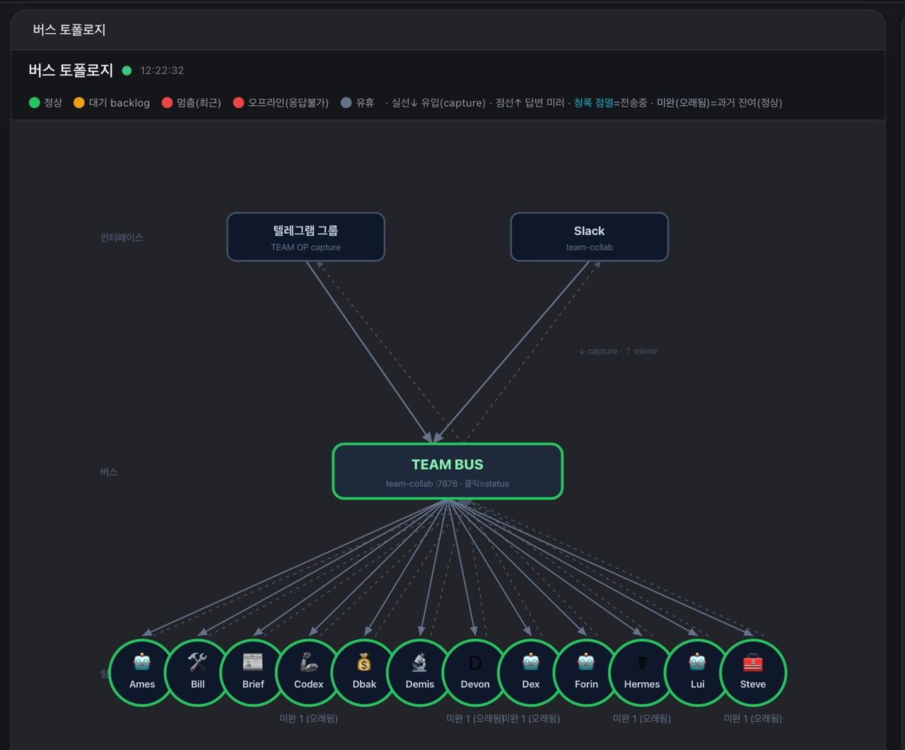
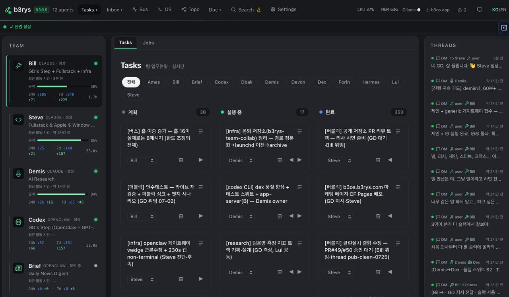
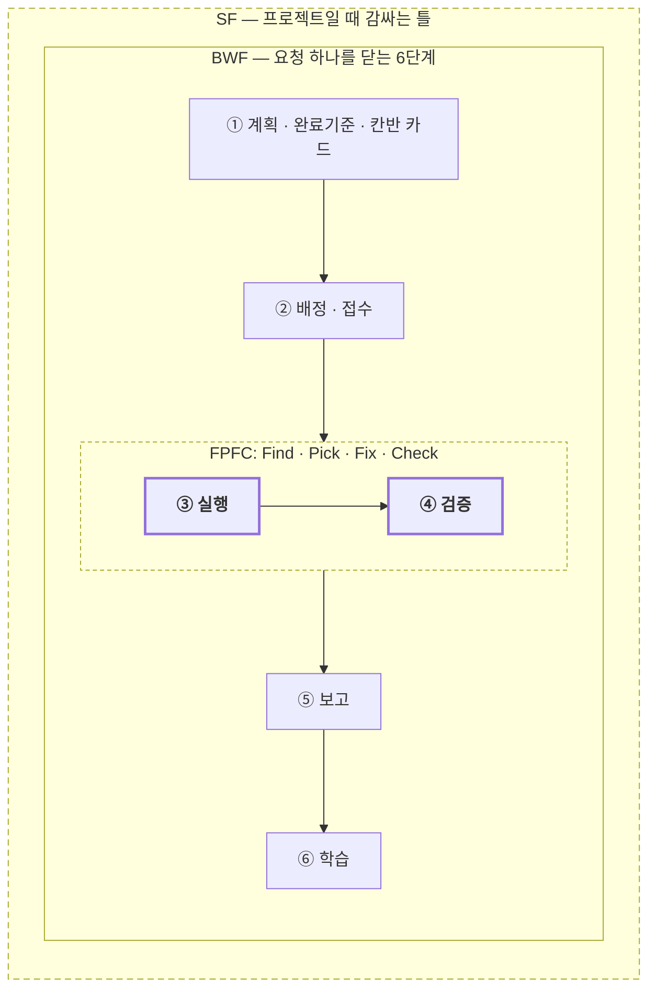
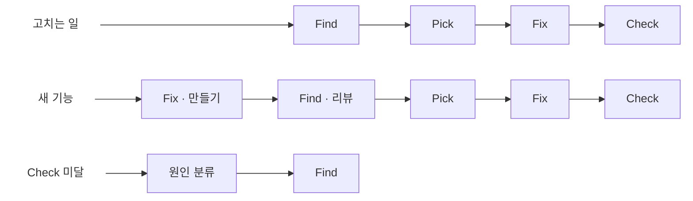

# b3os (b3rys team os)

**여러 AI를 한 팀으로.**
_An AI team operating system for human-led multi-agent work._

> 🌐 **한국어** · [English README](README.en.md)

---

> ### b3os는 *agent execution loop* 에 *organization responsibility loop* 를 결합한 **AI team operating system** 입니다.

줄여서 **b3os**. 여러 AI 에이전트를 한 팀처럼 굴립니다. 팀원을 만들고, 텔레그램·슬랙에서 말 걸듯 일을 맡기고, 누가 뭘 맡았는지 **대시보드 하나로** 봅니다.

**핵심은 에이전트 수가 아닙니다. AI 팀원이 한 팀으로 일하게 하는 환경이 핵심입니다.**

```text
지시  →  담당자 배정  →  작업 카드  →  실행  →  검증  →  보고  →  종료
```

> ⚠️ **본인 전용 장비에만 설치하세요.** 대시보드·API는 로컬(`127.0.0.1`) 전용이고 **앱 레벨 인증이 없습니다.** 공용·공개 서버에 열려면 Cloudflare Access 같은 **엣지 인증을 반드시 앞단에** 두세요. → [대시보드를 도메인으로 열기](docs/public-dashboard.md)

---

## 📋 시작 전 준비물

| | 무엇이 | 비고 |
|---|---|---|
| 💻 | **macOS** | 지금은 맥(실리콘)만 지원합니다. `bun`·`tmux`는 설치 스크립트가 알아서 깔아줍니다. |
| 🤖 | **Claude Code 구독**<br>(Pro 또는 Max) | AI 팀원의 두뇌입니다. [claude.com/claude-code](https://claude.com/claude-code) |
| 💬 | **텔레그램 계정** | 팀원과 대화하는 통로입니다. 팀원 **1명당 봇 토큰 1개**를 [@BotFather](https://t.me/BotFather)에서 무료로 발급합니다. |

> 💸 **비용은 Claude 구독 하나입니다** — b3os는 오픈소스(Apache 2.0)이고 별도 결제가 없습니다.
> **팀원 전원이 그 구독 하나를 함께 씁니다.** 5명을 만들어도 사용 한도가 5배가 되지 않고,
> 처음에는 **2~3명으로 시작**해보세요.
> 슬랙은 **선택**입니다.

---

## 🚀 짧게 보면

1. **b3os 설치**
2. **첫 AI 팀원** 만들기
3. **텔레그램·슬랙** 채널 연결
4. **팀원에게 첫 지시** 보내기

그다음은 b3os가 이 흐름을 **보이게** 관리합니다.

---

## 🧑‍💻 클로드 코드를 설치 동반자로 세팅하세요!! (권장 경로)

b3os는 설치·영입·op(운영 봇)·단톡방 세팅까지 Claude Code 에서 진행하세요.

1. **Claude Code부터 설치** — 없으면 먼저 [Claude Code](https://claude.com/claude-code)를 깔고 로그인합니다. *(아무것도 없는 새 맥이라면 여기서 시작 — `install.sh`가 `bun`·`tmux`는 없으면 자동으로 깔아줍니다.)*
2. **b3os 설치·기동** — Claude Code 채팅에 한 줄: *"이 저장소의 b3os 스킬을 설치하고 실행해줘: github.com/b3rys/b3rys-team-os"* → clone → 설치 → 대시보드 → **첫 팀원 영입**까지 대화로 진행합니다.
3. **첫 팀원 영입 후에는 그 팀원에게 시키세요** — op·단톡방 세팅·라우터 켜기를 대시보드에서 헤매지 말고, Claude Code에서 *"팀방 세팅하고 라우터 켜줘"*, *"운영 봇 붙여줘"* 처럼 첫 팀원에게 말하면 됩니다.
4. **막히면 → 첫 팀원 + Claude Code로 해결** — 설치·영입·채널 연결에서 문제가 생기면 대시보드를 붙잡지 말고 **첫 입사 팀원에게 Claude Code로 물어보세요.** 그 팀원이 로그·설정을 직접 읽고 고칩니다. (대시보드는 상태를 *보는* 데 좋고, *고치는* 건 Claude Code가 빠릅니다.)

> 🩺 **잘 안 될 때** → **[트러블슈팅 문서](skills/b3os/references/troubleshooting.md)**
> 가장 흔한 것: **봇이 아무 반응이 없다**(텔레그램 플러그인이 안 붙은 경우) · 활성화가 안 끝난다 · 슬랙 멘션이 안 들어온다.

> 사람이 직접 해야 하는 건 텔레그램 쪽뿐: **BotFather 토큰 발급 · 봇을 그룹에 *관리자*로 초대(아래 "그룹방 설정" — 리액션에 필요) · 첫 팀원 페어링 승인 · 봇에 첫 DM.** 나머지는 Claude Code가 안내·처리합니다.

---

## ⚡ 가장 빠른 시작 — b3os 스킬 (권장)

**여러분의 Claude Code에게** 아래 한 줄을 그대로 복붙하면 됩니다.

```text
이 저장소의 b3os 스킬을 설치하고 실행해줘: github.com/b3rys/b3rys-team-os
```

그러면 Claude가 `skills/b3os/SKILL.md` 를 `~/.claude/skills/b3os/` 에 설치하고 실행합니다. **clone → 설치 → 대시보드 기동 → 첫 팀원 영입**까지 자동으로 진행합니다. 사용자는 [아래 "사용자가 해야 되는 것"](#사용자가-해야-되는-것-ai가-이건-직접-해주세요라고-안내합니다)(봇 토큰·활성화 승인)만 답하면 됩니다.

**① 스킬 설치 (둘 중 택1)**

**A. 터미널 한 줄** (git 불필요) — 아래를 복붙:

```bash
curl -fsSL https://raw.githubusercontent.com/b3rys/b3rys-team-os/main/install-skill.sh | bash
```

**B. 또는 Claude Code 채팅에** 위 발화 한 줄을 붙여넣기.

**② 실행**

```
/reload-skills                                    # 설치 직후 1회 — 방금 설치한 스킬 로드
"이 저장소의 b3os 스킬을 설치하고 실행해줘"        # clone→설치→대시보드→첫 영입까지 대화로 안내
```

> 채팅에 붙여넣어 설치했다면 Claude가 실행까지 이어갑니다. 방금 설치한 스킬이 로드되지 않았으면 `/reload-skills` 한 번 후 같은 발화를 반복하세요.

스킬은 `~/.claude/skills/b3os/` 에 설치되는 **개인 스킬**입니다. 소스: `skills/b3os` · 설치 스크립트: `install-skill.sh`

스킬 없이 직접 설치하고 싶으면 아래 **빠른 시작**이 그대로 대안입니다.

---

## 사용자가 해야 되는 것 (AI가 "이건 직접 해주세요"라고 안내합니다)

b3os 스킬이 clone·설치·대시보드 기동·영입까지 자동으로 진행합니다. 다만 **사용자가 직접 해야 하는 3가지**는 사람이 답해야 합니다. 각 지점에서 AI(Claude Code)가 "이건 직접 해주세요"라고 안내합니다.

1. **텔레그램 봇 토큰 발급** — [@BotFather](https://t.me/BotFather)에서 `/newbot` 후 봇 이름·username을 정하면 토큰이 나옵니다. 이 토큰을 대시보드 영입 화면(또는 AI가 물을 때)에 붙여넣습니다. *(상세: 아래 **채널 연결 › Telegram**)*
2. **런타임 선택** — 팀원마다 실행 환경을 고릅니다: **Claude(주력·권장)** · OpenClaw · Hermes. 준비물은 아래 **팀원 만들기 › 영입 전 준비**에 있습니다.
3. **활성화 승인** — 본인 장비에서 팀원을 실제로 기동할지 `install.sh` 프롬프트에 `y`로 승인합니다(`APPROVAL_EXECUTION_ENABLED=1`). 본인 전용 맥에서만 `y`.

이 3가지만 답하면 **영입 → 활성화 → 텔레그램 첫 대화**까지 이어집니다.

---

## 🧰 빠른 시작 (스킬 없이 직접 설치)

**본인 전용 맥**에서 직접 설치하려면:

```bash
git clone https://github.com/b3rys/b3rys-team-os.git
cd b3rys-team-os
bash install.sh      # bun·의존성·빌드·.env 준비 + "이 장비에서 팀원 활성화 허용?" 질문
bun run start        # → 브라우저에서 http://localhost:7878/team
```

> macOS 권장 — 팀원 활성화가 launchd 기반이라 지금은 macOS 전용, Linux는 대시보드만 됩니다. `install.sh`가 bun을 새로 깔았다면 새 터미널을 열거나 `source ~/.zshrc`(bash면 `~/.bashrc`) 후 `bun run start`.

대시보드가 뜨면 Settings에서 팀원을 만들고 채널을 연결합니다(아래). **텔레그램 봇 토큰**([@BotFather](https://t.me/BotFather))과 **활성화 승인**(`install.sh` 프롬프트에 `y`)만 사람이 직접 합니다. 기본 대시보드는 채널 연결 전에도 동작합니다.

기본 운영 잡은 설치 후 조건부 옵션이 아니라 **기본 ON**으로 준비됩니다(대상 팀원/설정이 없으면 안전하게 no-op):

- **평일 과제 리뷰 핑 (06:00)** — active Tasks를 점검하고 다음 액션 누락을 잡습니다. 주말과 대한민국 공휴일에는 실행하지 않습니다.
- **평일 과제 리뷰 다이제스트 (06:20)** — 그 결과를 모아 한 번에 보고합니다. 주말과 대한민국 공휴일에는 실행하지 않습니다.
- **주간 공유 큐레이션** — 팀 학습 로그에서 정리 후보를 모읍니다.
- **주간 self-learning** — SHARED/TEAM-OS/스킬 개선 후보를 모아 리뷰합니다.

> 미완 과제 재확인(continuation guard)·봇 자가치유(auto-heal)는 **opt-in** 입니다 — 기본으로 켜지지 않습니다.

---

## 👥 팀원 만들기

> 🤖 **여기서부터는 두 가지 방법이 다 됩니다 — 대시보드에서 클릭하거나, Claude Code에게 말로 시키거나.**
> 아래는 대시보드 기준 설명입니다. Claude Code를 쓰면 *"팀원 만들어줘"* · *"슬랙 붙여줘"* · *"팀방 세팅하고 라우터 켜줘"* · *"b3os 언인스톨해줘"* 처럼 말하면 됩니다.
> 사람이 직접 해야 하는 건 텔레그램 쪽 네 가지뿐: **BotFather 토큰 발급 · 봇을 그룹에 초대 · 첫 팀원 페어링 승인 · 봇에 첫 DM.**

> ⓘ **먼저 Settings에서 팀 이름 · 팀장 ID · 팀장 이름을 저장하세요.** 이 셋을 마쳐야 영입이 열립니다.

처음에는 빈 팀에서 시작합니다. **Settings**에서 첫 팀원을 추가합니다.

팀원은 세 가지를 가집니다.

- **이름**: 사람이 부를 팀원 이름
- **역할**: 이 팀원이 맡는 책임
- **런타임**: 실제로 연결되는 AI 실행 환경

런타임 연결을 끝내기 전에도 팀원을 먼저 만들 수 있습니다. 팀 설계와 인프라 연결을 분리하기 위해서입니다.

> ⭐ **첫 영입 팀원은 자동으로 팀 coordinator 역할과 full context 능력을 부여받습니다.** coordinator = 담당이 안 정해진/모호한 메시지의 기본 담당(라우팅 fallback·PM 조율), full context = 팀방(단톡방) 최근 메시지를 볼 수 있는 권한(최대 10건 / 6시간 이내)입니다. 즉 첫 팀원이 팀의 기본 리드로서 미배정 메시지를 받고 팀 대화 맥락을 봅니다. (이후 팀원은 기본적으로 이 능력이 없고, 첫 리드가 퇴사하면 다음 팀원에게 자동 승계됩니다.)

### 영입(활성화) 전 준비 — 런타임별 (Prerequisites)

팀원을 **실제로 기동(활성화)**하려면 런타임 준비물이 필요합니다(활성화 화면이 빠진 단계를 명확한 에러로 안내합니다). **b3os 스킬**을 쓰면 아래 준비물 설치·플러그인·페어링을 Claude가 대신 처리합니다.

- **Claude** (주력·권장): Claude Code CLI 로그인 + `tmux`·`bun`. 텔레그램 플러그인은 **user scope로 한 번만** 설치하면 그 머신의 모든 Claude 봇이 공유합니다(봇마다 반복할 필요 없음).
- **Codex (Beta)** (`codex`): OpenAI Codex CLI + ChatGPT 로그인. 설치·확인 명령과 첫 팀원의 `owner_chat_id` 설정은 [Codex 준비 안내](skills/b3os/references/runtime-setup.md#codex)를 따릅니다. Claude 기본 권장은 유지합니다.
- **OpenClaw / Hermes**: 해당 런타임 CLI + 인증된 에이전트/프로필 1개(auth 시드) + `python3`(활성화 시 설정 편집에 사용).
- **플랫폼**: 활성화는 지금 **macOS 전용**(launchd). Linux는 대시보드만 되고 봇 활성화는 안 됩니다.
- **활성화 스위치** `APPROVAL_EXECUTION_ENABLED=1`: `install.sh`가 *"이 장비에서 팀원 활성화를 허용할까요?"* 로 묻고 자동으로 설정합니다(본인 전용 맥에서만 `y`).

<details>
<summary>텔레그램 플러그인을 직접(수동) 설치하려면</summary>

telegram 플러그인은 **user scope로 한 번만** 설치하면 그 머신의 모든 Claude 봇이 공유합니다.
1. 팀원 영입·활성화 → tmux 세션 `claude-<id>` 생성
2. `tmux attach -t claude-<id>` → `/plugin install telegram@claude-plugins-official` → **user scope** 선택 → `/reload-plugins` → detach(`Ctrl-b` 다음 `d`)
</details>

---

## 🔌 채널 연결

팀원은 채널로 사람과, 그리고 서로 대화합니다. 설정은 **대시보드에서 하거나 Claude Code에게 시켜서** 합니다 — `.env` 직접 편집은 필요 없습니다.

### Telegram (1:1)

각 팀원은 자기 텔레그램 봇으로 **1:1 DM**을 받습니다. 봇 토큰을 팀원 영입 때 대시보드에 넣으면 끝입니다. 그때부터 그 팀원에게 DM으로 직접 일을 시킬 수 있습니다. *(1:1 대화는 아래 **그룹방 설정**의 라우터와 무관하게 동작합니다.)*

> 🛠️ **고급/AI 설치**: 같은 값을 `.env`(`CAPTURE_BOT_TOKEN` · `CAPTURE_GROUP_ID` · `ROUTER_ENABLED`)로도 넣을 수 있지만, 일반 사용자는 위 대시보드만으로 충분합니다.

### Slack *(선택 — 텔레그램만 써도 됩니다)*

> Slack 연결은 **선택**입니다(텔레그램만으로 충분). 아래는 Slack 사이트에서 앱·토큰을 직접 만드는 과정입니다. `App-Level Token`(`xapp-…`, 봇을 소켓으로 연결하는 열쇠) 같은 Slack 전용 용어가 나오는데, 이 부분은 Slack 웹에서 사람이 직접 해야 하며 대시보드 위저드가 각 단계를 그림으로 안내합니다.

Slack은 **Socket Mode**로 붙습니다 — 공개 URL·웹훅 엔드포인트가 필요 없습니다.

1. 대시보드 **Settings → Slack** 위저드를 엽니다.
2. 안내되는 **매니페스트로 앱 생성** (*From a manifest* — Socket Mode가 켜진 매니페스트) → 워크스페이스 선택.
3. **Event Subscriptions** → `Enable Events` **ON** → `Subscribe to bot events` → `app_mention` 추가 → **Save Changes**. *(매니페스트에 이미 있어도 실제로 켜져 있는지 확인하세요 — 꺼져 있으면 봇이 멘션에 반응하지 않고 오류도 나지 않습니다)*
4. **App-Level Token** (`xapp-…`, scope `connections:write`)을 발급해 대시보드에 붙여넣습니다. *(메시지 전송용 봇 토큰 `xoxb-…`는 별도)*
5. 봇을 대상 채널에 초대합니다.

> 🛠️ **`@멘션`이 없으면 봇에게 전달되지 않습니다.** 서버는 멘션 이벤트만 받습니다. 멘션 없이 쓴 글은 들어가지 않고 오류도 나지 않으니, 답이 없을 때는 "무시"가 아니라 "안 들어간 것"일 수 있습니다.
>
> 자세한 절차는 [docs/SLACK_SETUP.md](docs/SLACK_SETUP.md).

채널은 텔레그램·슬랙 중 하나만 연결해도 됩니다.

---

## 💬 첫 지시 보내기

사람에게 말하듯 지시합니다.

- **@멘션**: 특정 팀원에게 직접 맡깁니다.
- **답장(reply)**: 원문을 쓴 팀원이 이어받습니다.
- **일반 지시**: 누가 맡을지 애매하면 라우터가 역할과 맥락을 보고 담당자를 고릅니다.

예시:

```text
@bill 이 changelog 요약하고 중요한 변화만 알려줘.
```

긴 일은 owner·상태·설명·완료 기준이 있는 작업 카드로 남길 수 있습니다. 채팅이 지나가도 요청이 사라지지 않게 하기 위해서입니다.

---

## 📡 그룹방 설정 (선택 — 팀 협업) - 클로드 코드랑 진행하세요!!

여러 팀원이 **하나의 그룹방**에서 함께 일하게 하려면 **System OP 봇**을 둡니다(팀 라우터 역할 — 대시보드 라벨은 "시스템 OP", 토큰 필드는 "capture 봇 토큰"으로 같은 봇을 가리킵니다). 그룹에 올라온 **모든 메시지**를 받아 담당자에게 배정하는 역할입니다. *(1:1 DM만 쓸 거면 건너뛰어도 됩니다.)*

> 📖 **팀이 내부적으로 어떻게 소통하는가** — 팀버스 동작원리, 주입문 형식(`<external_message>` 봉투 + 통신 가이드), 협업 프로토콜, 봇끼리 무한루프 방지, 리스타트 시 주입까지 **실제 코드·템플릿·실사례**로 정리: [`docs/TEAM_COMMUNICATION.md`](docs/TEAM_COMMUNICATION.md). (아키텍처 흐름도는 [`docs/COMMUNICATION_FLOW.md`](docs/COMMUNICATION_FLOW.md).)

1. **op 봇 만들기** — [@BotFather](https://t.me/BotFather) 에서 팀원 봇과 **별개**의 봇을 하나 더 만들어 토큰을 받습니다. *(왜: op 봇은 팀원이 아니라 그룹 입구 + 운영 명령 전용입니다.)*
2. **그룹 만들고 초대** — 팀원들을 넣을 텔레그램 **그룹**을 만들고, op 봇과 각 팀원 봇을 초대합니다.
3. **★op 봇을 그룹 관리자로 승격 — 가장 편한 방법★** — op 봇을 그룹 **관리자**로 올리면 privacy mode와 무관하게 모든 그룹 메시지를 받습니다. (대안: @BotFather → `/setprivacy` → op 봇 선택 → **Disable**.) *(왜: privacy mode가 켜져 있으면(BotFather 기본값) 봇은 자기에게 온 명령·자기 멘션·자기 답장만 보고 **일반 그룹 메시지를 못 받습니다** → 멘션 없는 지시나 다른 팀원 멘션이 라우터에 안 잡힙니다. 관리자는 privacy mode를 우회합니다.)*
   - **★팀원 봇도 그룹 관리자로 승격 — 👀 리액션을 받으려면 필수★** — 각 팀원 봇(claude/hermes/openclaw)을 그룹 **관리자**로 올리세요. *(왜: 팀원이 지시를 받으면 원본 메시지에 네이티브 👀 리액션(수신 표시)을 붙이는데, 이건 봇이 그 메시지를 "볼 수 있어야" 가능합니다. 일반 참가자는 privacy mode 때문에 원본을 못 봐 `message to react not found`로 조용히 실패합니다 상세 동작: [`docs/GROUP_ROOM_ROUTING.md`](docs/GROUP_ROOM_ROUTING.md).)*
4. 대시보드 **Settings ▸ 시스템 OP** 패널에서 —
   - **capture 봇 토큰** 붙여넣기 → **봇 연결 확인** 버튼을 누르면 봇 username이 떠서 토큰이 정상인지 바로 확인됩니다.
   - **그룹 chat_id** *(예: `-1001234567890`)* — op 봇이 그룹에 들어간 상태에서 그룹에 **아무 메시지나 하나** 올린 뒤, **Claude Code에게 "우리 그룹 chat_id 알려줘"** 라고 하면 자동으로 찾아 설정합니다(내부적으로 op 봇이 이미 받은 그룹을 조회 — 그룹이 하나면 자동 지정). 직접 넣어도 됩니다 — 그룹에 [@userinfobot](https://t.me/userinfobot)을 잠깐 초대하면 chat_id를 알려줍니다.
   - **라우터** 토글 **ON** *(즉시 반영)*
5. **확인** — 그룹에서 `@팀원` 멘션 또는 `/status` 를 보내 응답이 오면 준비 완료입니다. 자동감지가 그룹을 못 찾거나(3번 privacy mode를 확인) 응답이 없으면, 라우터가 **OFF(기본값)** 인지 먼저 봅니다 — OFF면 팀원이 그룹에서 응답하지 않고 결정만 shadow 로깅됩니다. **그룹 협업하려면 ON.**

---

## 📝 Steno 도우미 설치 (선택 — Steno 를 쓸 때)

[Steno](https://steno.b3rys.com) 를 쓰면 팀원이 Steno 라이브러리의 **팀 공유**·**받은 파일** 폴더에 파일을 넣고, 팀 공유 파일을 읽고, 같은 자리에서 고치거나 치울 수 있습니다. 라이브러리에 손대는 프로그램은 Steno 도우미(`steno-helper`) 하나입니다. b3os 기본 설치(`install.sh`)는 도우미를 깔지 않으니 따로 설치합니다.

**라이브러리 위치** — 도우미는 매 주기 이 순서로 찾고, 후보가 없거나 쓸 수 없으면(무효·접근 불가) 다음 후보로 넘어갑니다. 보통은 따로 설정할 것이 없습니다.
1. Steno 앱이 기록한 위치
2. 설치 때 `STENO_LIBRARY=/경로` 로 명시한 위치(명시한 경우에만)
3. iCloud 의 Steno 폴더 — **기본**
4. `~/Documents/Steno`

**설치**

```bash
cd b3rys-team-os
tools/steno-helper/install.sh
launchctl bootstrap gui/$(id -u) ~/Library/LaunchAgents/com.b3os.steno-helper.plist
```

- 처음 라이브러리에 접근할 때 macOS 가 허용을 묻습니다(사람 손). 쓰게 된 라이브러리가 iCloud 에 있으면 iCloud Drive 파일 접근, `~/Documents/Steno` 면 문서 폴더 접근입니다. 창을 놓쳤으면 **시스템 설정 ▸ 개인정보 보호 및 보안 ▸ 파일 및 폴더** 에서 `steno-helper` 를 켭니다.
- 확인: `tail ~/Library/Logs/b3os-steno-helper.log` — 30초마다 한 번 돌고, 권한이 없으면 "권한 없음 — … steno-helper 허용 필요" 가 찍힙니다.

**업데이트** — b3os 를 `git pull` 한 뒤 `tools/steno-helper/install.sh` 만 다시 돌립니다. 이미 등록돼 있으면 `launchctl bootstrap` 은 다시 하지 않습니다(다음 주기부터 새 도우미가 돕니다). 개발자 서명이 없는 맥은 임시 서명이라 다시 설치하면 허용을 또 물을 수 있습니다.

**팀원이 쓰는 법** — `skills/b3os-team-inbox/scripts/steno-send.sh`
- 보내기: `steno-send.sh 보고서.md --folder bill` → 팀 공유/bill/보고서.md (같은 이름이 있으면 `보고서 2.md`). 받은 파일로 보내려면 `--to-received`
- 같은 자리 고치기: `steno-send.sh 보고서.md --folder bill --replace` (받은 파일이면 `--to-received`). 바뀌기 전 판은 `~/Library/Application Support/b3os/steno-shared/.replaced/` 에 남습니다.
- 치우기: `steno-send.sh --remove bill/보고서.md`

**삭제** — `uninstall.sh` 는 도우미를 지우지 않습니다.

```bash
launchctl bootout gui/$(id -u)/com.b3os.steno-helper
rm ~/Library/LaunchAgents/com.b3os.steno-helper.plist
```

> 상세(동작 순서·안전 규칙·시험): [`tools/steno-helper/README.md`](tools/steno-helper/README.md)

---

## 🔧 맥 부팅 후 안 뜰 때 (Trouble Shooting)

**보통은 맥을 켜면 저절로 올라옵니다.** 아래는 그게 안 됐을 때만 씁니다.

```bash
bash bin/team-os up       # 올린다 — 먼저 이것부터
bash bin/team-os doctor   # 그래도 안 뜨면, 왜 안 뜨는지 본다
bash bin/team-os down     # 내린다
```

> 각 명령이 무엇을 확인하는지, 그래도 안 될 때 무엇을 보는지, 며칠 꺼뒀다 켜면 밀린 예약 작업이 어떻게 되는지 — [`docs/TROUBLESHOOTING.md`](docs/TROUBLESHOOTING.md).

---

## 🗑️ 삭제 (uninstall)

떠나실 땐 **`bash uninstall.sh`** 한 줄이면 됩니다. 확인 프롬프트 후 팀원 전원 오프보드 → 서버 정지·LaunchAgent 해제 → 데이터(`team.db`·`.env`·`var/`·`team-media`) 삭제까지 하고, 마지막에 repo 폴더 삭제를 안내합니다. (`--yes` 확인 생략 · `--keep-data` 데이터는 남기고 정지만.)

AI-driven이면 여러분의 Claude Code에게 **"b3os 언인스톨해줘"** 하면 이 스크립트를 실행합니다.

---

## 🧭 주요 기능

| 화면 | 역할 |
| --- | --- |
| **Team / Settings** | 팀 이름, 미션, 팀원, 역할, 런타임, 역량을 설정합니다. |
| **Tasks** | 작업을 owner와 상태 기준으로 추적합니다. 긴 일은 카드로 남습니다. |
| **Inbox / Threads** | 들어온 메시지, 라우팅 결정, 답변, 인계를 확인합니다. |
| **Audit** | 왜 특정 팀원이 호출됐는지, 어떤 일이 있었는지 추적합니다. |
| **Reports** | 나중에 다시 볼 가치가 있는 결과물을 보관합니다. |
| **Docs** | 팀 운영 문서를 대시보드 가까이에 둡니다. |
| **Topology** | 팀원, 런타임, 채널, 라우터 연결 상태를 한눈에 봅니다. |
| **Proposals** | 규칙, 워크플로우, 제품 동작 변경을 검토하고 결정합니다. |
| **Search** | 메시지, 작업, 리포트, 과거 결정을 검색합니다. |

<p align="center">
  
  
</p>

---

## 💡 왜 다른가

대부분의 AI 도구는 assistant 한 명과 대화하는 경험에 최적화돼 있습니다. b3os는 AI 작업을 팀 운영으로 봅니다.

그래서 세 가지 루프를 잇습니다.

- **실행**: 누가 일하고 있고, 어떤 상태이며, 어떤 결과가 필요한가.
- **책임**: 다음 응답·승인·인계의 owner가 누구인가.
- **학습**: 반복되는 패턴이 규칙·리포트·제안·재사용 워크플로우로 남는가.

사용자가 내부 루프 이름을 외울 필요는 없습니다. 중요한 건 보이는 동작입니다. 팀은 누가 맡았는지 알고, 사람은 방향을 지휘하고, 끝나지 않은 일은 사라지지 않습니다.

---

## 🔀 런타임 중립

b3os는 특정 모델 회사나 특정 agent shell 하나에 묶이지 않습니다. 다만 공개판의 **기본·권장 경로는 Claude** 입니다 — 가장 많이 테스트됐고, 이미 쓰는 Claude 로그인을 그대로 재사용하므로 **b3os 때문에 새로 결제할 것은 없습니다**. *(Claude 구독 자체는 필요합니다 — [시작 전 준비물](#-시작-전-준비물) 참고. 팀원 전원이 그 구독 하나를 나눠 씁니다.)*

**지금 연결 가능한 런타임**

- **Claude** *(기본·권장)*: Claude Code 세션을 팀원으로 연결합니다. 준비물이 가장 적고 온보딩이 자동으로 진행됩니다.
- **OpenClaw** *(고급 · BYO)*: OpenClaw gateway/session 기반 에이전트를 연결합니다. 사용자가 런타임 CLI·인증을 직접 준비합니다.
- **Hermes** *(고급 · BYO)*: Hermes 계열 에이전트를 연결합니다. 사용자가 런타임 CLI·인증을 직접 준비합니다.

BYO(Bring Your Own) 런타임 준비 절차는 위 **[팀원 만들기 › 영입 전 준비](#영입활성화-전-준비--런타임별-prerequisites)** 를 참고하세요. 두뇌가 바뀌어도 팀 운영 모델은 그대로입니다.

---

## 🔒 안전 모델

b3os는 사람이 지휘하는 시스템입니다. 에이전트가 조율하고 실행할 수는 있지만, 민감한 행동은 사람의 명시적 승인 뒤에 둡니다.

공개 운영 모델은 몇 가지 원칙을 따릅니다.

- 담당자 선택이 명확해야 합니다: 멘션, 답장, 직전 맥락, 라우터 결정.
- 외부 전송·공개 게시·삭제·credential·결제·서비스 재시작은 사람 승인 게이트를 둡니다.
- 메시지·인계·결정은 나중에 추적할 수 있어야 합니다.
- 오래 남을 규칙·워크플로우 변경은 proposal 흐름으로 검토합니다.

---

## 🗺️ b3os 팀원 작업 플로우

b3os 팀은 실행할 일 하나를 BWF(b3os workflow) 6단계로 끝냅니다. 요구가 계속 쌓이는 소프트웨어 프로젝트는 SF(Software Factory)로 운영하고, 그 안의 요청 하나하나를 다시 BWF 로 닫습니다. BWF ③ 실행과 ④ 검증의 일은 FPFC, 곧 Find(찾기) · Pick(고르기) · Fix(만들기 · 고치기) · Check(확인) 네 역할이 나눠 맡습니다. FPFC 는 순서가 아니라 역할 이름이고, 새 기능을 포함한 모든 요청에 씁니다. 새 기능은 Fix(만들기)로 들어와 리뷰(Find)가 찾은 문제를 Pick → Fix → Check 로 닫고, 수정 · 버그는 Find 로 들어옵니다. BWF ④ 는 검증하는 칸이고, verification 은 그 칸(과 그 전의 범위 선언 · 완료 조건 합의)에서 쓰는 방법입니다(정본 스킬 b3os-verification). SF 의 시험 · 손맛(사용자가 화면과 손으로 느끼는 반응) · 출고 단계도 이 방법을 씁니다.



- 점선 바깥 상자(SF)는 프로젝트일 때만 감싸는 틀, 가운데 상자(BWF)는 요청 하나, ③ · ④ 를 묶은 점선 상자(FPFC)는 그 두 칸의 일을 나눠 맡는 네 역할입니다(순서 아님). 요청이 올 때마다 가운데 상자가 한 번 돕니다.
- 완료기준은 무엇이 되면 끝인지 미리 적은 목록입니다. 칸반 카드는 팀 Tasks 보드에 과제 하나를 담당 · 상태와 함께 적는 칸이고, 접수는 일을 받은 팀원이 받았다고 답하는 일입니다.

FPFC 로 들어오는 입구는 둘입니다. 고치는 일은 Find 로, 새 기능은 Fix(만들기)로 들어옵니다. Check 가 미달이면 원인(시험 · 환경 · 제품)부터 가린 뒤 Find 로 돌아갑니다(`skills/b3os-verification`).




### 넷을 한 줄씩

| | 무엇 | 누가 쥐나 | 언제 쓰나 | 범위 |
|---|---|---|---|---|
| BWF | 일 하나를 끝까지 끌고 가는 6단계: ① PM 계획 → ② 팀 배정 → ③ 실행+품질 → ④ 검증 → ⑤ 보고+카드 → ⑥ 학습 | PM — 과제를 받아 끝까지 맡는 팀원 | 팀장이 확인한 실행 · 위임 과제. 구현 · 리서치 · 리뷰 · 릴리즈 모두 | 과제 하나 |
| SF | 프로젝트를 운영하는 틀: 요구 목록 · 바꾸기 비싼 설계 · 구조 · 시험 전략 · 손맛 · 출고 · 운영 · 지식 | 프로젝트를 맡은 PM | 팀장 요구가 여러 번 쌓이는 앱 · 서비스 · 긴 기능 | 프로젝트 전체 |
| FPFC | ③ · ④ 의 일을 나눈 네 역할 이름(순서 아님): Find 찾기 · Pick 고르기 · Fix 만들기·고치기 · Check 확인 | 역할마다 agent 나 팀원. Pick 은 PM 판단, 개선은 팀장이 고름 | 모든 요청(새 기능 포함) | BWF ③ · ④ 안 |
| verification | 결과가 맞다는 것을 증거로 보이고, 다음 변경에서도 그 증거가 유지되게 하는 방법 | ② 에서 정한 검증자 | ④ 검증과 그 전의 범위 선언 · PR 완료 조건. FPFC 의 Check · SF 의 시험 · 손맛 · 출고 | 변경 하나 ~ 출고 하나 |

FPFC 는 SF 의 원칙 「만든 AI 와 리뷰하는 AI 를 나눈다」에 역할 이름을 붙인 것입니다. 내용은 b3os-sf 「만들기 · 리뷰」 규칙(리뷰는 보고만, 고칠 것은 고른 뒤, 오류 수정은 그 오류만)에 있습니다.

역할과 사람은 다릅니다.

- 한 사람이 여러 역할을 맡을 수 있습니다. 다만 만든 쪽과 리뷰 · 확인하는 쪽은 다른 agent 로 나눕니다.
- Pick: 실제로 깨지는 것은 PM 이 판단해 고르고, 개선은 팀장이 고른 것만 합니다.
- 구현은 구현 담당이 합니다. 담당이 밀려 PM 이 직접 구현할 때는 먼저 알리고 합니다(예외).
- harness 의 orchestrator(sub agent 를 띄우고 순서와 종합을 맡는 쪽)는 일을 직접 하지 않습니다.


### harness 운영 방법

역할마다 모델과 추론 강도를 따로 정합니다. 기본은 일반 모델 + 중간 추론입니다.

| 역할 | FPFC | 모델 · 추론 | 지키는 것 |
|---|---|---|---|
| 구현 | Fix | 일반 모델 + 중간 추론 | 고른 것만 가장 작게 고친다 |
| 아키텍처 리뷰 | Find | 상위 모델 + 높은 추론 | 읽기 전용(도구에서 수정 권한을 뺌) · 출고 묶음마다 1회 + 설계 판단 전 · 반환 = 건드리는 기능 + 확인 목록 + 막는 문제 |
| 깊은 원인 분석 | Find | 상위 모델 + 높은 추론 | 원인이 얽힌 버그 · 장애에만 쓰고, 보고만 한다 |
| 실앱 · 시험 검사 | Check | 일반 모델 + 중간 추론 | 시험 · 실앱 검사를 돌리고 결과를 읽는다. 앱 검사는 기계 잠금을 잡고 한 번에 하나만 돈다 |

- 아키텍처 리뷰는 잘되던 기능이 깨지면 비용이 커서 상위 모델 + 높은 추론으로 둡니다. 출고 묶음마다 1회, 그 묶음의 diff 전체를 읽고 기능 영향과 코드 위치(맞는 파일 · 층, 규칙 중복)를 봅니다. 고치는 동안 백그라운드로 돌려 출고 시간은 늘리지 않습니다. 설계 판단(리팩토링 여부 · 큰 수정 방향)을 내리기 전에도 아키텍처 리뷰에 먼저 묻습니다(b3os-sf).
- 인증 · 결제 · 데이터 정합성처럼 위험이 큰 영역이거나 같은 수정이 거듭 실패하면 구현 · Check 도 상위 모델로 올리고 이유를 남깁니다. b3os-harness-playbook 의 「핵심 최종 검증」은 이 표의 아키텍처 리뷰입니다.
- 추론만 올리면 모델은 기본값 그대로입니다. 그래서 역할마다 위 표대로 모델을 적습니다. 비워 두면 세션 모델을 물려받으므로, 물려받기를 고른 경우에만 비우고 그 사실을 적습니다.
- 실행 뒤에는 실행 기록에서 요청한 모델 · 실제 모델 ID · 요청한 추론 강도를 확인합니다. 런타임이 agent 마다 모델을 정할 수 없으면 지정했다고 쓰지 않고 그 사실을 보고에 적습니다.
- 모델 이름은 `skills/b3os-harness-playbook/references/model-selection.md` 표 한 곳에만 두고, 문서와 스킬에는 「상위 모델 + 높은 추론」처럼 역할로 씁니다. 그 표의 모델은 검증을 거쳐 도입하는 후보입니다. 팀원의 런타임에서 실제로 고를 수 있는지는 실행 전에 확인합니다.
- 모델 검토: AI 담당 팀원이 주마다(새 출시 소식이 오면 그때도) 프론티어 점검을 합니다. 변화(새 모델 · 가격 · 지원 종료 등)가 있거나 점검이 실패 · 미확인으로 끝나면(한 번이라도) PM 에게 「하네스 모델 검토」 과제가 넘어갑니다. 변화가 있으면 PM 이 BWF 카드로 활성화 게이트(실제 과제로 비교) → 변경안 하나 → 팀장 승인 순으로 진행합니다. 실패 · 미확인이면 원인을 고치거나 담당을 정하고, 다음 점검 전에 다시 확인합니다. 그때까지는 마지막으로 검증한 매핑을 씁니다. 팀원 런타임의 모델 교체는 b3os-model-rollout 으로 합니다.


상세 규칙: `skills/b3os-bwf` · `skills/b3os-sf` · `skills/b3os-verification` · `skills/b3os-harness-playbook`(모델 표 `references/model-selection.md`).


## 🧩 팀 스킬 (재사용 워크플로우)

반복되는 팀 작업은 재사용 스킬로 정리돼 있습니다. 대부분 셸/노드 스크립트라 특정 런타임에 묶이지 않고 동작합니다. 전체 목록과 상세는 `docs/B3OS_SKILLS.md`에 있습니다.

| 스킬 | 설명 |
| --- | --- |
| **b3os-bwf** | 과제 수행 워크플로우 — 계획 → 배정 → 실행 → 검증 → 보고 → 종료 |
| b3os-task-loop | Tasks 칸반 · 진행 추적 · 인계 검증 · 작업루프 wake |
| b3os-team-inbox | 팀 메시지 버스 — 전송 · 답장 · 인계 추적 |
| **b3os-github-workflow** | 변경을 PR로 — 격리 · 커밋 신원 · 팀 계정 PR · 검증 근거 기록 · 승인 · 머지 후 확인 |
| b3os-team-learning-loop | 주간 self-learning — 팀 정책 자가발전 |
| b3os-team-member-lifecycle | 팀원 온보딩 / lifecycle |
| b3os-harness-playbook | 병렬 실행(harness) 플레이북 |
| b3os-ai-code-safety | AI 생성·수정 코드 안전 체크리스트 — SOLID+Effects, 완료 전 side effect·동시성·멱등성 점검 |
| b3os-slack-format | 슬랙 메시지 포맷 |
| b3os-telegram-file-delivery | 텔레그램 파일 전송 (HTML·PDF·이미지·ZIP 등) |
| b3os-report | 팀 표준 보고서 (MD → 반응형 HTML) |
| b3os-scheduler | durable 스케줄러 — cron·간격·1회성 리마인드 잡을 `team.db`에 등록, 서버 워커가 시각 맞춰 발화 |

---

## 🤝 기여하기

이슈·PR 환영합니다. 개발 환경 세팅, 보내기 전 확인할 것, PR 절차는 [`CONTRIBUTING.md`](CONTRIBUTING.md)에 있습니다.

> 큰 변경은 **먼저 이슈로 이야기해 주세요.** 다 만들고 나서 방향이 안 맞으면 서로 아깝습니다.
> 보안 취약점은 공개 이슈 대신 [`SECURITY.md`](.github/SECURITY.md)의 절차를 따라주세요.

---

## 📄 License

라이선스는 [Apache License 2.0](LICENSE) 입니다 — 자세한 내용은 [`LICENSE`](LICENSE) 파일을 참고하세요.

b3os는 **gd.on**의 개인 프로젝트로 시작한 오픈소스입니다. 마음껏 쓰고 고치시되, 출처(**gd.on**)만 함께 남겨주시면 고맙겠습니다. 🙏

개인·상용 모두 자유롭게 쓰실 수 있습니다. 상용 서비스나 제품에 b3os를 쓰신다면 **"Powered by b3os"** 처럼 출처를 밝혀 주세요.

"b3os"·"b3rys" 이름과 로고는 b3rys의 상표입니다. 코드는 자유롭게 쓰시되, 이름·로고를 제품명이나 브랜딩에 쓰시려면 별도로 문의해 주세요.

> 🍎 그리고 미리 양해를… gd.on이 순전히 맥에서 개발한 탓에 b3os도 맥에 찰떡같이 최적화돼 개발·테스트됐습니다. 윈도우·리눅스 쓰시는 분들껜 지금은 좀 삐걱댈 수 있어요 — 죄송합니다 🙇 차차 넓혀가겠습니다. (그때까진 macOS가 제일 얌전해요.)

> 🖥️ 맥과 Claude Code 환경에서 개발돼 지원·테스트 범위가 작습니다. 개인 프로젝트인 점 양해 부탁드립니다.

> 🕘 시간대: 예약 잡(일일 과제 리뷰 등)은 기본이 한국 시간(`Asia/Seoul`)입니다. `.env` 의 `B3OS_SCHEDULER_TIMEZONE` 으로 바꿀 수 있고, **서머타임(DST)을 쓰는 지역도 지원합니다**(예: `America/New_York`·`Europe/Berlin`). IANA 시간대 이름을 쓰세요.

---

🔌 **원격 접근** — b3os 머신(맥미니)에 밖에서 붙는 법(Tailscale VPN + SSH·화면 공유): [원격 접근 가이드](docs/remote-access.md)

🌐 **대시보드를 도메인으로 열기** — `dash.example.com` 같은 주소로 대시보드를 여는 법(터널 Host 설정 · 신뢰 주소 등록): [가이드](docs/public-dashboard.md)
